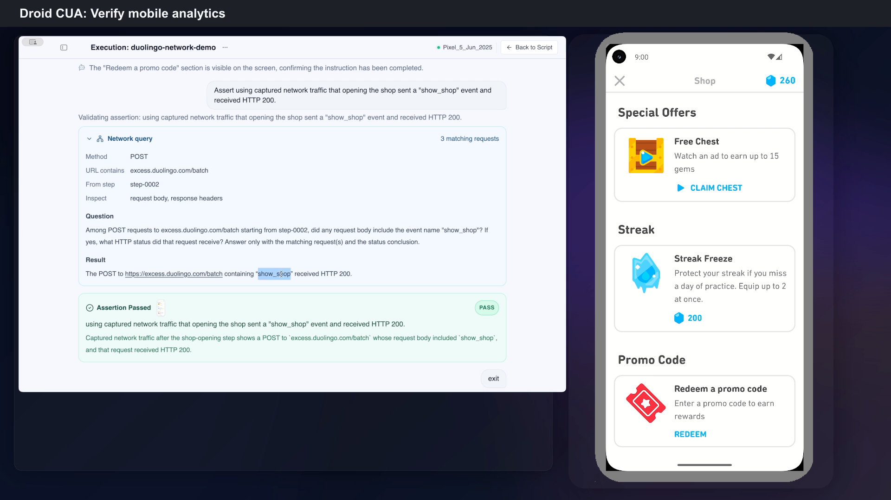

# Network Capture and Assertions

Network capture lets Droid check the HTTP requests and responses behind a user journey, not just what appears on screen. Use it to verify that the app sent the right data, received the expected response, or carried a value from one request into another.

Capture is optional. Enable it only for tests that need network evidence.

***

## Choose your target

| Target | Network capture |
| --- | --- |
| Local Android emulator | Supported with certificate and proxy setup. Use a rootable AOSP or Google APIs image on Android 16 (API 36) or earlier, without Google Play. |
| Physical Android device | Supported with manual certificate and Wi-Fi proxy setup. The app must trust the Droid CA. |
| Physical iPhone | Supported on macOS with a USB connection, manual certificate trust, and Wi-Fi proxy setup. |
| Local Chrome or Edge | Supported without certificate or proxy setup. |

The instructions below cover local emulators, physical devices, and browsers. Cloud device and cloud browser runs do not support network capture.

***

## Android emulator

Start with an emulator that meets the requirements above and your app installed. See [Setup](setup.md#android-setup) if you have not connected it to Droid yet.

1. Connect the emulator in Droid.
2. Choose **Tools → Install Network Certificate**. Droid creates a certificate if needed and installs it on the emulator so it can inspect HTTPS traffic.
3. Restart the app under test if it was already running.
4. Turn on **Settings → Network Capture** in Droid.
5. In the emulator's Android Wi-Fi settings, edit the connected network and set its proxy to **Manual**. Use `10.0.2.2` as the proxy hostname and `8765` as the port.
6. Run your test with a network assertion, as shown below.

Keep Droid open while the emulator uses this proxy. When finished, set the Wi-Fi proxy back to **None**. Droid does not change or clear the emulator's proxy settings for you; leaving the proxy enabled after closing Droid can prevent the emulator from connecting to the internet.

***

## Physical Android or iPhone

Connect the phone to Droid over USB. For Android, enable USB debugging and authorize the computer. For iPhone, complete [Physical iPhone setup](setup.md#physical-iphone-setup) on a Mac first. Put the phone and computer on the same trusted Wi-Fi network; the network and computer firewall must allow the phone to reach port `8765`.

1. Choose **Tools → Install Network Certificate** with the phone connected. Droid creates a network certificate if needed, then helps you transfer it to the phone:

   * **iPhone:** Choose **Send to iPhone** and use AirDrop. On the phone, install the profile from **Settings → Profile Downloaded**, then enable full trust for the Droid CA under **Settings → General → About → Certificate Trust Settings**.
   * **Android:** Droid copies a `.crt` certificate to the phone's **Downloads** folder. Install it from **Settings → Security → Encryption & credentials → Install a certificate → CA certificate**. Names vary by vendor; search Settings for "CA certificate" if needed. If Droid cannot copy the file, the dialog shows the local file to transfer yourself.

2. Turn on **Settings → Network Capture** in Droid and use the computer's LAN address shown in the device log.
3. Set the phone's Wi-Fi proxy to **Manual**, using that address as the server and `8765` as the port. On iPhone this is under **Wi-Fi → your network → Configure Proxy**; on Android, edit the connected Wi-Fi network's proxy settings.
4. Restart the app under test and run the test with a network assertion.

Certificate installation, trust, and phone proxy settings are manual. USB controls the phone; Wi-Fi carries the traffic to the proxy. Use the computer's LAN address, not `127.0.0.1` or the emulator-only `10.0.2.2` address.

On physical Android, the app must allow user-installed CAs in its network security configuration. Use a debug or QA build configured for this; installing the certificate alone does not make every app trust it. Droid does not root the phone or install system certificates on it. Apps with certificate pinning may also prevent HTTPS inspection.

Keep Droid open while testing and turn the phone's proxy off afterward. While enabled for a physical device, the proxy is reachable by other devices on the local network, so use a trusted network.

***

## Browser

1. [Connect a local Chrome or Edge browser](web-testing.md#connect-a-local-browser) in Droid.
2. Turn on **Settings → Network Capture**.
3. Run your test. No certificate installation or browser proxy configuration is needed.

Capture starts when the test starts. Requests made before the run are not included, and Droid does not automatically reload an already open page. Start your saved test with `navigate:` when you need to capture the initial page load:

```text
navigate: https://bank-demo.loadmill.com
```

***

## Add a network assertion

Describe what you want checked in the test, just as you would a visible result. Be specific about the request and the values that matter:

```text
Create a transfer of $200 to Alex.
Verify that the transfer appears with the status "Pending".
Assert using captured network traffic that POST /api/transfer/initiate sent amount 200 and recipient Alex, and returned status PENDING.
```

This is an example; use your app's actual endpoint and expected values. Keep the UI assertion when the visible result matters, and add the network assertion for behavior the screen cannot confirm.

You can also compare values across requests:

```text
Assert using captured network traffic that the POST to /pageview after opening Home contains the item_id returned by /home.
```

In the desktop run details or HTML report, expand the **Network query** card to see the question and answer.



In this demo, Droid searches the captured traffic for the `show_shop` event and confirms that the matching request received HTTP 200.

***

## Run from the CLI

For mobile targets, complete the certificate and proxy setup first. Then close the desktop app so the CLI can use the same proxy port. For example, on an Android emulator:

```sh
droid-cua --avd adb:emulator-5554 --instructions tests/transfer.dcua --capture-network
```

For physical devices, use the phone's target instead: `--avd adb:YOUR_DEVICE_SERIAL` for Android or `--avd ios-device:auto` for iPhone. The iPhone token selects iOS automatically. Set the phone's Wi-Fi proxy to the computer's LAN address and port `8765`, and clear it when finished. See [Run a saved iPhone test](cli.md#run-a-saved-iphone-test) for iPhone readiness checks and Apple team selection.

For a local browser, no proxy setup is needed:

```sh
droid-cua --target web --browser chrome --instructions tests/transfer.dcua --capture-network
```

***

## If traffic is missing

* On mobile devices, check the Wi-Fi proxy settings and that Droid is running. For physical phones, also check the shared Wi-Fi network and computer firewall.
* If HTTPS reaches the proxy but cannot be read, check certificate trust and restart the app. On Android, the app must trust the Droid CA, not just the phone. Apps that enforce certificate pinning may not allow their HTTPS traffic to be inspected.
* In a browser, make sure the action that sends the request happens during the test, not before it starts.

Missing traffic is not proof that the app did not send a request. WebSocket messages are not captured, and some response bodies may be unavailable or too large to inspect.

Captured traffic can contain passwords, tokens, and personal data. Review capture files before sharing them.
