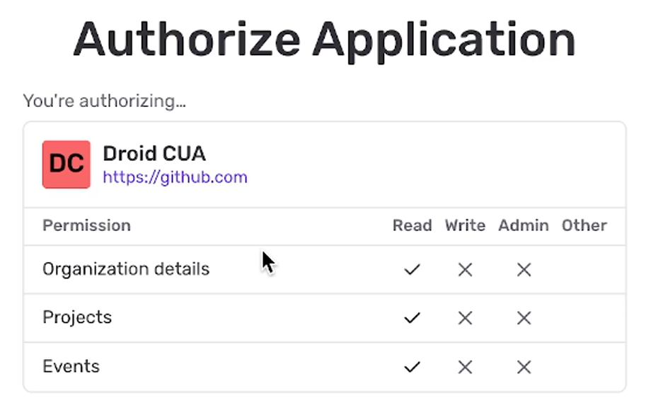
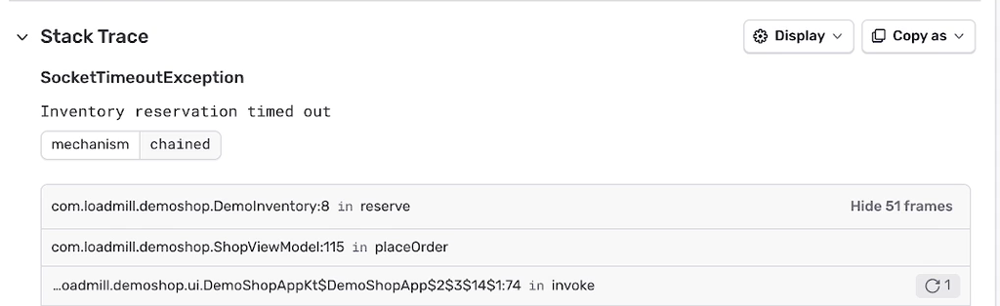

# Sentry Integration

Connect Sentry to Droid to see which app errors might explain a failed test. For example, the Demo Shop checkout only says “We couldn’t place your order.” Droid’s report shows that an inventory reservation request timed out and links to the Sentry event where you can inspect the stack trace.

## Before you start

* Your app must already send errors to a Sentry project. If it does not, start with [Sentry’s SDK setup for your platform](https://docs.sentry.io/platforms/) and confirm that the project receives events from the build you test.
* Use a Sentry account that can access the organization and projects you want Droid to read. Droid supports Sentry SaaS organizations in the US and EU.
* Run a mobile test on Android or iOS, locally or on a supported cloud device, or a web test in local Chrome or Edge. Cloud browser runs are unsupported.

Sentry collection works with or without [Full Network Capture](network-capture.md). The Sentry integration requires no Droid proxy or certificate setup.

## Connect Sentry in Droid

1. Open your account menu in Droid and choose **Integrations**.
2. Under **Observability**, open **Sentry** and click **Connect Sentry**.
3. In your browser, sign in to Sentry, confirm that the code matches the one in Droid, and authorize the organization that contains your app’s project. Droid requests read access to organization details, projects, and events.

   

4. Back in Droid, turn on **Enable Sentry error collection**. Under **Apps (Sentry projects)**, select each project you want Droid to search, then click **Save settings**.

   

If Droid asks you to choose a Sentry organization after approval, select the organization from the dropdown and click **Continue**.

Droid connects to one Sentry organization at a time. Use **Reconnect Sentry** to switch organizations, or **Refresh projects** to reload the list for the connected organization.

## Investigate a failed test

Open the failed run in Droid and look below the failed step for **Root Cause Analysis**. It can explain how an app error relates to the failure and show the Sentry events used as evidence. In the Demo Shop example, the test expected an order confirmation. The app showed a generic error, and a Sentry event pointed to an inventory timeout.


Choose **Open event** to inspect that occurrence in Sentry or **Open issue** to see the group of related occurrences. **Trace** or **Replay** can also appear when available for the event.



For mobile tests, Droid searches the selected projects over the full test window, including when the test starts on the home screen or switches between apps. **Possible match** means the event may be related. Compare its timing and details with the failed step before drawing a conclusion. For local Chrome and Edge tests, Droid looks for Sentry uploads from the browser test session.

If an error hasn’t appeared yet, check that Sentry received it and that its project is selected. For a saved mobile run, choose **Recheck errors** in **Run details** to search the original test window again.

## Use Sentry from the CLI

Add `--sentry` to each [CLI](cli.md) run that should collect Sentry errors. Configure either a personal token or the saved desktop connection as described below.

### Set up a personal token for CLI or CI

1. In Sentry, open **User settings → Personal Tokens** and create a token with `org:read`, `project:read`, and `event:read` permissions. Use an account with access to the projects under test. See [Sentry API authentication](https://docs.sentry.io/api/auth/).
2. Set `SENTRY_AUTH_TOKEN` and `SENTRY_ORG` in a gitignored `.env` in the test project. Use the organization's slug, which you can copy from **Organization slug** in Droid's Sentry integration or find in Sentry under **Organization settings → General Settings**.
3. Run `droid-cua sentry projects` to list accessible projects. Set `SENTRY_PROJECT_IDS` to the numeric IDs of the projects your app sends errors to, separated by commas.

Your completed `.env` should have these entries, using your own values:

```dotenv
SENTRY_AUTH_TOKEN=your-personal-token
SENTRY_ORG=your-organization-slug
SENTRY_PROJECT_IDS=123,456
```

If you already connected Sentry in the desktop app, **CLI & CI setup → Copy .env template** fills in the organization slug and currently checked project IDs. Replace `generate-your-own` with the personal token you created. The copied IDs include any changes to the checkboxes that you have yet to save.

The CLI loads `.env` from the directory where you run the command. In [CI](ci.md#include-sentry-errors), inject the token from your secret store and set the organization slug and project IDs as job variables. Existing environment variables take precedence over `.env`.

### Check access and run a test

Run `sentry status` to check the active credential source, organization, and selected projects, then run your saved test with `--sentry`:

```sh
droid-cua sentry status
droid-cua run tests/checkout.dcua \
  --avd adb:emulator-5554 \
  --sentry \
  --report ./checkout-report.html
```

Replace the test path and device with your own. For local web tests, use `--target web --browser chrome` instead of `--avd`.

A failed test can print a Sentry event count and a **Root Cause Analysis** explanation. Open the HTML report to review the supporting events and follow their Sentry links. An error occurring during the test is a possible match, so compare the evidence with the failure.

Runs without `--sentry` skip Sentry validation and collection, even when credentials are configured. If Datadog is also configured, add `--datadog` to collect errors from both providers.

### Use the saved desktop connection

When all three Sentry environment variables are unset, CLI runs with `--sentry` use the desktop app's saved connection and project selection on the same computer. You can also configure that connection from the CLI:

```sh
droid-cua sentry login
droid-cua sentry projects
droid-cua sentry projects --select 123,456
```

Replace the IDs with those listed for your projects. If login needs an explicit organization, use `droid-cua sentry login --organization your-organization-slug`.

Setting any of `SENTRY_AUTH_TOKEN`, `SENTRY_ORG`, or `SENTRY_PROJECT_IDS` selects the environment configuration. Supply the complete configuration or unset all three to use the saved connection. `sentry login`, `sentry logout`, and `sentry projects --select` manage the saved connection. Update `SENTRY_PROJECT_IDS` to change a token-based selection.

### If Sentry errors are missing

* Check that the run included `--sentry` and that the app sent an event to one of the selected projects.
* Run `droid-cua sentry status` from the same directory and environment as the test. If Sentry rejects the token, replace it and check access again. For denied access, check the token permissions and project access.
* Check the run's Sentry warnings. Invalid credentials or incomplete settings produce a warning while the test continues, so a completed test alone does not confirm that Sentry collection worked.
* For a delayed mobile event, use **Recheck errors** on the saved report or run `droid-cua observability recheck ./checkout-report.html` to search the original window again.

### Find the report in Droid Runs

CLI reports upload to the [Droid Runs dashboard](runs-dashboard.md) when a Loadmill connection is available. `--report ./checkout-report.html` also saves a local copy. If you used `--no-cloud-report`, remove it and rerun to upload the report and screenshots.
