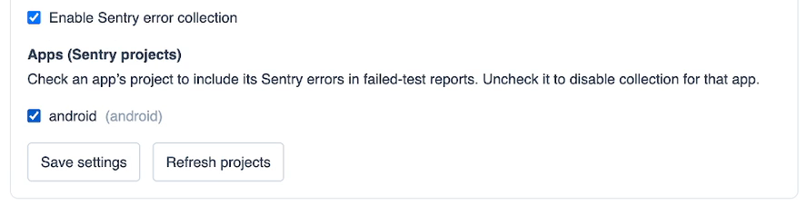
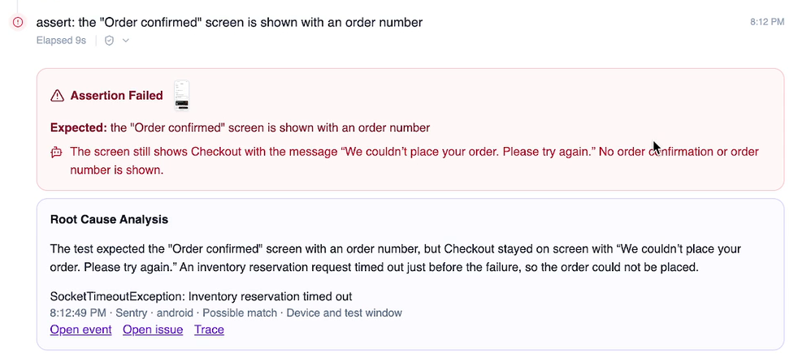

# Sentry Integration

Connect Sentry to Droid to see which app errors might explain a failed test. For example, the Demo Shop checkout only says “We couldn’t place your order.” Droid’s report shows that an inventory reservation request timed out and links to the Sentry event where you can inspect the stack trace.

## Before you start

* Your app must already send errors to a Sentry project. If it does not, start with [Sentry’s SDK setup for your platform](https://docs.sentry.io/platforms/) and confirm that the project receives events from the build you test.
* Use a Sentry account that can access the organization and projects you want Droid to read. Droid supports Sentry SaaS organizations in the US and EU.
* Run the test on a physical Android device or iPhone connected to your computer, a local Android emulator or iOS simulator, or a local Chrome or Edge browser. Cloud-hosted devices and browsers are unsupported.

Sentry collection works with or without [Full Network Capture](network-capture.md). The Sentry integration requires no Droid proxy or certificate setup.

## Connect Sentry in Droid

1. Open your account menu in Droid and choose **Integrations**.
2. Under **Observability**, open **Sentry** and click **Connect Sentry**.
3. In your browser, sign in to Sentry, confirm that the code matches the one in Droid, and authorize the organization that contains your app’s project. Droid requests read access to organization details, projects, and events.

   

4. Back in Droid, turn on **Enable Sentry error collection**. Under **Apps (Sentry projects)**, select each project you want Droid to search, then click **Save settings**.

   

Droid connects to one Sentry organization at a time. Use **Reconnect Sentry** to switch organizations, or **Refresh projects** to reload the list for the connected organization.

## Investigate a failed test

Open the failed run in Droid and look below the failed step for **Root Cause Analysis**. It can explain how an app error relates to the failure and show the Sentry events used as evidence. In the Demo Shop example, the test expected an order confirmation. The app showed a generic error, and a Sentry event pointed to an inventory timeout.



Choose **Open event** to inspect that occurrence in Sentry or **Open issue** to see the group of related occurrences. **Trace** or **Replay** can also appear when available for the event.


For mobile tests, Droid searches the selected projects over the full test window, including when the test starts on the home screen or switches between apps. **Possible match** means the event may be related. Compare its timing and details with the failed step before drawing a conclusion. For local Chrome and Edge tests, Droid looks for Sentry uploads from the browser test session.

If an error hasn’t appeared yet, check that Sentry received it and that its project is selected. For a saved mobile run, choose **Recheck errors** in **Run details** to search the original test window again.

## Use Sentry from the CLI

The desktop app and [CLI](cli.md) share the Sentry connection and selected projects on the same computer. To connect directly from the CLI, run:

```sh
droid-cua sentry login
droid-cua sentry projects
droid-cua sentry projects --select 123,456
```

Replace the example IDs with the projects returned by `droid-cua sentry projects`. Run your test normally. Add `--no-sentry` to skip Sentry collection for a single run.
