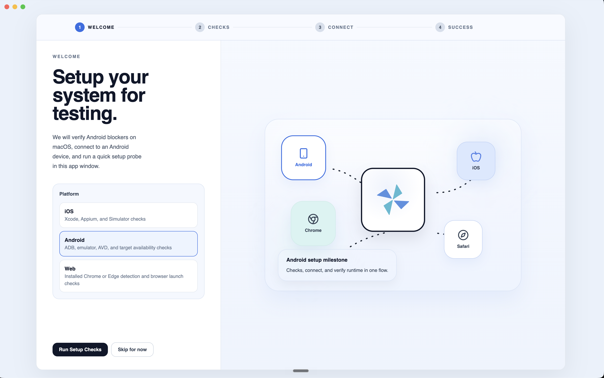
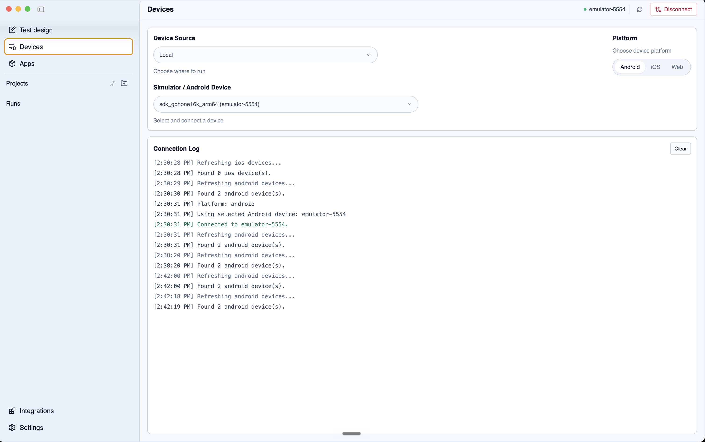

# Setup

This page covers the basic setup required before running Droid CUA tests on mobile devices, cloud devices, and browsers.

***

## Desktop app

Download and install the Droid CUA desktop app:

* [Mac](https://github.com/loadmill/droid-cua-release/releases/latest/download/Loadmill-Droid-CUA.dmg)
* [Mac Intel](https://github.com/loadmill/droid-cua-release/releases/latest/download/Loadmill-Droid-CUA-intel.dmg)
* [Windows](https://github.com/loadmill/droid-cua-release/releases/latest/download/Loadmill-Droid-CUA-Setup.exe)

After installation, launch Droid CUA and sign in with your Loadmill account.

When you open Droid CUA for the first time, the setup wizard helps you choose a platform and run the required checks.



***

## Android setup

To test Android apps, Droid CUA needs access to a physical Android device or an Android emulator.

Install and configure:

* Android Debug Bridge (ADB)
* Android Emulator CLI, if you want Droid CUA to launch emulators
* USB debugging on physical Android devices

To confirm ADB is available, run:

```sh
adb version
```

To confirm a device or emulator is visible, run:

```sh
adb devices
```

If the device appears in the list, Droid CUA should be able to connect to it from the desktop app.

Use the **Devices** page to choose the device source, platform, and target device.



***

## iOS simulator setup

iOS simulator testing is available on macOS only.

Install and configure:

* Xcode
* iOS Simulator
* Appium
* XCUITest driver

After setup, open Droid CUA and choose an installed simulator from the device picker.

Use the platform selector on the **Devices** page to switch between Android, iOS, and web targets.

***

## Physical iPhone setup

On macOS, Droid can test apps already installed on an iPhone connected by USB, including TestFlight, App Store, and your team's builds. Droid signs and installs a small helper app, **WebDriverAgent**, using your Apple Developer team. It does not install the app under test or reset the phone, so a dedicated test iPhone is recommended.

### Before you start

You need:

* A Mac with Xcode that supports the phone's iOS version. Open Xcode once to complete its initial setup, and install the iOS platform under **Xcode → Settings → Components**.
* An Apple ID signed into **Xcode → Settings → Apple Accounts**, belonging to a **paid Apple Developer team**. Your account needs at least the **Developer** role and **Access to Certificates, Identifiers & Profiles**. Free Apple IDs are not supported.
* Appium and the XCUITest driver, as for simulator testing.
* An iPhone connected by USB, with the app you want to test already installed.

### Connect the phone

1. Unlock the iPhone and tap **Trust** when asked to trust the Mac.
2. Enable **Settings → Privacy & Security → Developer Mode** on the phone. Let it restart, then confirm Developer Mode and enter your passcode.
3. In Droid, open **Help → Run Setup Wizard** and choose **iPhone (USB)**.
4. Follow the **Connect iPhone** checklist. Use **Set up signing** and **Install helper app** when offered. If you belong to multiple paid Apple teams, choose the team Droid should use; the desktop app remembers it.
5. Connect the iPhone and run the setup probe. For later sessions, choose **iOS → Local** on the **Devices** page and select the phone from **Simulator / iPhone**.

Keep the phone unlocked while testing. Set **Settings → Display & Brightness → Auto-Lock → Never** for test sessions. After a restart or helper installation, the phone may ask for your passcode to allow automation. If it locks during a run, Droid pauses until you unlock it.

Local iPhone testing supports one phone at a time and requires someone available to approve prompts. Device control is USB-only, and local `.ipa` installation is not supported. The implementation has been verified on iOS 26; iOS 17–26 are expected to work, but iOS betas and iOS 27 are not supported yet.

See [CLI](cli.md#run-a-saved-iphone-test) for terminal runs. Certificates and Wi-Fi proxy setup are only needed for [Network Capture and Assertions](network-capture.md#physical-android-or-iphone), not ordinary UI tests.

***

## Web setup

To test web flows, install a supported browser:

* Google Chrome
* Microsoft Edge

Droid CUA uses Playwright with the installed browser for web execution. In the CLI, use `--target web` with `--instructions`.

```sh
droid-cua --target web --browser chrome --instructions tests/search.dcua
```

Use `--browser edge` to run against Microsoft Edge.

For browser session modes, the page-frame boundary, cloud browsers, and guidance on choosing Droid Web, Playwright, or API testing, see [Web Testing with Droid](web-testing.md).

***

## Cloud device setup

Droid CUA supports cloud mobile runs from the CLI.

### Loadmill Cloud

Loadmill Cloud is a paid feature. Contact [Loadmill Support](mailto:support@loadmill.com) to discuss access and have it enabled for your account before using it.

After access is enabled, you need:

* A Loadmill API token.
* A target platform: `android` or `ios`.
* The cloud device name and OS version.
* An app build: `.apk` for Android or `.ipa` for iOS.

Set your API token in your shell or CI environment:

```sh
export LOADMILL_API_TOKEN=your-loadmill-api-token
```

Use `--device-source loadmill-cloud` with the platform, device, app, and saved test when you run the CLI. See [CLI](cli.md) for an example.

### LambdaTest

LambdaTest is another cloud-device option available from the CLI.

You will need:

* `LAMBDATEST_USERNAME`
* `LAMBDATEST_ACCESS_KEY`
* A target platform, such as `android` or `ios`
* A cloud device name and OS version
* An app build: `.apk` for Android or `.ipa` for iOS

Set the credentials in your shell or CI environment:

```sh
export LAMBDATEST_USERNAME=your-username
export LAMBDATEST_ACCESS_KEY=your-access-key
```

Then run Droid CUA with `--device-source lambdatest`.

***

## Project setup

Create a Droid CUA project and choose:

* A tests folder for saved `.dcua` files.
* A results folder for run history, reports, and logs.

Keeping `.dcua` files in your app repository makes it easier to review them, commit them, and run the same tests later with the CLI.

If your test needs a mobile app build, add it from the **Apps** page. Droid CUA can manage `.apk`, `.ipa`, and `.app` builds.

***

## App context

For real app testing, create a short `context.md` file next to your tests. You do not need to complete it before creating the first test; build it alongside the journey as you discover reusable product knowledge.

Use it to explain details the agent cannot infer from the screen alone, such as:

* What the app does.
* Which test accounts to use.
* Important screen names and navigation paths.
* Common success messages.
* Any confusing or similar-looking buttons.

Good context makes tests more reliable because the agent has the same product knowledge a teammate would need before testing the app.

See the [Droid Mobile Testing Quickstart](getting-started.md#start-contextmd-while-you-create-the-test) for a first-project example and [Writing Reliable Droid CUA Tests](best-practices.md#build-context-alongside-the-test) for guidance on what belongs in each project file.

***

## Setup troubleshooting

If setup does not work as expected, see [Setup troubleshooting](setup-troubleshooting.md).
